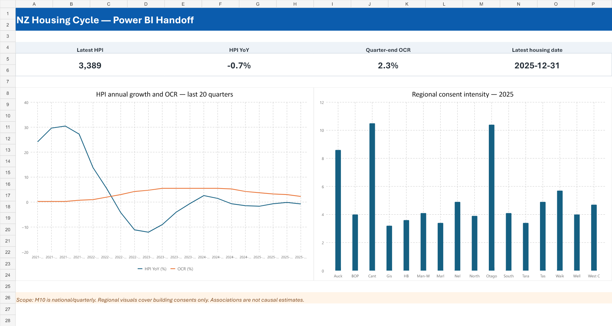

# NZ Housing Market Cycle Analysis

How did New Zealand house prices move through the interest rate cycle, and how did regional price growth and dwelling approvals differ? This project covers national housing and policy rates from 2010 to 2025, regional house price growth through 2025, and regional dwelling approvals from 2023 to 2025.

## Data sources

| Source | Series and frequency |
|---|---|
| [RBNZ M10 Housing](https://www.rbnz.govt.nz/statistics/series/economic-indicators/housing) | National quarterly HPI, sales, stock value and residential investment |
| [RBNZ Monetary policy decisions](https://www.rbnz.govt.nz/monetary-policy/monetary-policy-decisions) | Official Cash Rate decision dates, curated in [the project input](data/reference/ocr_decisions.csv) |
| [MCERT Property and Sales Statistics](https://www.hud.govt.nz/stats-and-insights/property-and-sales-statistics/about-the-dashboard) | Monthly house price indices for 16 regions |
| [Stats NZ Building consents issued](https://www.stats.govt.nz/information-releases/building-consents-issued-december-2025/) | Annual regional dwelling approvals and approvals per 1,000 residents |

The pipeline expands the curated decision dates in `data/reference/ocr_decisions.csv` to month-end rates. For the official downloadable OCR series, open [Wholesale interest rates (B2)](https://www.rbnz.govt.nz/statistics/series/exchange-and-interest-rates/wholesale-interest-rates) and go to **Data files**. Use **Daily close (1985–2017)** for the 2010–2017 portion and **Monthly close (2018-current)** for 2018 onward. Select the **Official Cash Rate (OCR)** series and take the last available observation of each month in the daily file.

## Key Insights (Executive Summary)

- **National snapshot:** In 2025 Q4, the M10 HPI was 3,389, down 0.73% year over year, and the quarter-end OCR was 2.25%.
- **National timing:** In the saved one-quarter lag model, a 1 percentage point higher prior-quarter OCR level was associated with 3.49 percentage points lower annual HPI growth (95% interval: −5.87 to −1.12; 60 observations). The specification includes a time trend. This is a historical association.
- **Regional prices:** The separate MCERT index shows that Southland (+5.96%) led the 15 comparable regions from December 2024 to December 2025. Canterbury rose 1.65% and Auckland fell 2.40%. Gisborne lacks a December 2024 observation and is unranked.
- **Regional supply:** In 2025, Canterbury and Otago recorded 10.5 and 10.4 new dwelling approvals per 1,000 residents, respectively. These are separate supply indicators. Their relationship to regional price movements has not been estimated.

---

## Methods and scope

- The national pipeline aligns M10 housing observations with quarter-end OCR values. It fits separate OLS models for lags of one to four quarters, with a linear time trend and HAC standard errors. The saved estimates use the NumPy Newey–West fallback.
- The event table reports subsequent HPI changes after quarters with an OCR change. The models and event summaries describe historical associations.
- The regional pipeline compares the same calendar months across regions and preserves missing observations. The published comparison measures year-end growth. It does not estimate regional policy sensitivity or recovery from earlier price peaks.
- Building consents measure approvals. They are analysed separately from prices. Migration and other potential explanatory variables are outside the fitted models.

## Reproduce the analysis

1. Download the M10 workbook from the source table and save it as **data/raw/hm10.xlsx**.
2. Download the MCERT workbook and save it as **data/raw/nz-mcert-hpi.xlsx**.
3. Install dependencies and run the scripts from the repository root.

```bash
pip install -r requirements.txt
python run_pipeline.py
python run_regional_analysis.py
```

Browse the [notebooks](notebooks/), [processed data](data/processed/powerbi/), [Power BI setup](dashboard/README.md), and [dashboard workbook and previews](outputs/powerbi_handoff/). The repository provides the data model and handoff for building the Power BI report.



See the [pipeline notes](architecture/README.md) for the project structure.
